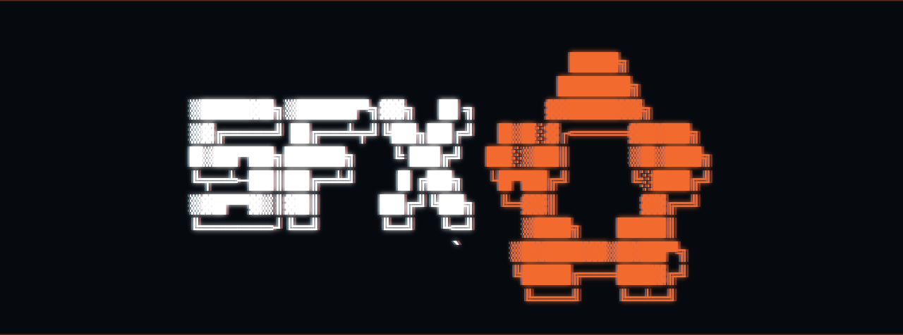

# sfx

<div align="center">
    <br>
</div>

# Introduction

An explorer for [Azure Service Fabric](https://learn.microsoft.com/azure/service-fabric/) clusters, in the terminal
and in the browser. Browse nodes, applications, services, partitions and replicas; read health, manifests, upgrades
and load; and run cluster operations, with confirmations and an action log.

In the terminal, `sfx`:


In the browser, `sfx ui`:


## Installation

As a .NET tool (needs the ASP.NET Core 10 runtime, which the .NET 10 SDK includes):

```bash
dotnet tool install -g sfx
```

Or download a self-contained binary for your platform from the
[releases](https://github.com/mircodz/sfx/releases), unpack it, and put `sfx` on your `PATH`. On macOS, a binary
downloaded with a browser is quarantined; clear it with `xattr -d com.apple.quarantine ./sfx`.

## Usage

```text
sfx [-c <context>]                           open a saved context (default: the active one)
sfx <endpoint> [--auth <methods>] [options]  open a cluster directly
sfx context <command>                        manage saved contexts
sfx ui [<endpoint> | -c <context>]           open the cluster in the browser instead
```

```bash
# An unsecured cluster, e.g. a local dev cluster
sfx localhost

# Client certificate, checking the cluster's certificate by common name
sfx mycluster.westeurope.cloudapp.azure.com --auth cert \
  --cert-file ~/certs/client.pfx --server-cn mycluster.westeurope.cloudapp.azure.com

# Microsoft Entra ID (device code sign-in)
sfx https://mycluster:19080 --auth aad --server-thumbprint 0123ABCD...
```

`sfx --help` lists every auth method and its options.

### Contexts

Save clusters once and switch between them with `c` or `:ctx <name>` in the UI. Contexts live in
`~/.sfx/config.toml` (or `$SFX_CONFIG`). With saved contexts but no active one, `sfx` asks which to open and makes it
the active one.

```bash
sfx context add prod mycluster:19080 --auth cert --cert-thumbprint AB12... --server-cn mycluster --readonly
sfx context add dev localhost --use
sfx context add prod-weu prod-weu.westeurope.cloudapp.azure.com --auth cert --cert-thumbprint CD34... --folder prod/europe
sfx context list
sfx -c prod
```

Folders group contexts in `sfx context list` and the `c` page; `sfx context move <name> <folder>` refiles one. A
`[folders.<path>]` table gives a folder a label and color (`success`, `warning`, `danger`, `accent` or `neutral`),
and `readonly = true` makes every context in it and its subfolders read-only:

```toml
[folders.prod]
label = "PROD"
color = "danger"
readonly = true
```

A `--readonly` context hides every action that changes the cluster. The riskiest actions (recover from quorum loss,
remove node state, delete…) stay hidden until unlocked with `:power`, or `--power` on the context.

### In the browser

`sfx ui` connects the same way, then serves a web UI on `127.0.0.1` and opens it: the cluster's health and why,
nodes (as a list or a map), applications down to services, partitions and replicas, manifests, upgrades with their
domains, and recent events. The same actions as in the terminal are there (restart, move, remove, deactivate…), plus
changing an application's parameters or version, scaling a service, and resuming or rolling back an upgrade. Each
asks for confirmation, follows the context's `--readonly` and power settings, and goes to `~/.sfx/actions.log`.

```bash
sfx ui -c prod                  # pick a free port and open the browser
sfx ui -c prod --port 7080 --no-browser
```

Only this machine can reach it, and only through the link it prints, which carries an access token.

### Keys

| Key | |
| --- | --- |
| `enter` / `l` | open the selected row |
| `d` | describe the selected row |
| `backspace` / `h` | back |
| `esc` | dismiss an error, then clear the marks, then the filter, then go back |
| `/` | filter rows, or search the text being read (`n` / `N` step through matches) |
| `:` | command, e.g. `:nodes`, `:apps`, `:cluster`, `:health`, `:ctx prod` (below); `tab` completes |
| `ctrl+p` | command palette |
| `ctrl+f` | find a node, application or service by name, type or address, or a partition by its id, and open it |
| `!` | the last error in full |
| `space` / `*` | mark the row / mark every row, to run an action on all of them at once |
| `:group` | group the rows by a column, e.g. `:group type`; `:group` alone stops grouping |
| `r` | refresh; `:refresh 2s`, `:refresh 1m` or `:refresh off` changes how often it refreshes on its own |
| `y` | copy the selected name, or the text being read |
| `?` | every key on the current page |
| `q` | quit |

On a describe page, `]` / `[` switch tabs, `#` shows line numbers and `w` wraps long lines. `up` / `down` in the
`:` and `/` prompts go through earlier entries, kept in a `history` file next to the config.

Besides nodes and applications, `:` opens views across the whole cluster:

| Command | |
| --- | --- |
| `:upgrades` (`:updates`) | the cluster's and every application's upgrade: versions, mode, domains done, state, running ones first |
| `:events` | the event store's events of the last hour, newest first; `:events 6h` looks further back |
| `:activity` | what you changed through sfx: this session's operations, running ones too, then the action log |
| `:repairs` | repair tasks: reboots, patching and other infrastructure work, active ones first |
| `:health` (`:unhealthy`) | everything unhealthy, with the reason in one line; `enter` opens it |
| `:cluster-health` | the cluster's own health evaluation |
| `:find <text>` (`:f`) | the same as `ctrl+f`, starting with `<text>`; a partition id goes straight to the partition |
| `:types` (`:apptypes`) | application types: version, status, how many applications use it, and their service types |
| `:store` (`:imagestore`) | the image store: folders and files with sizes, packages with their type and whether provisioned |
| `:provision <path>` | upload a package from disk (a folder, `.sfpkg` or `.zip`; `tab` completes the path) and provision it |
| `:error` | the last error in full, like `!` |

Actions on the selected entity use the same key everywhere: `ctrl+r` restart, `ctrl+k` remove, `ctrl+d` delete
(or unprovision a type), `m` move, `x` deactivate, `a` activate, `s` scale, `ctrl+n` create, `e` edit, `u` upgrade
(or steer the running upgrade), `o` go to a replica's node, `p` provision a package in the image store. Every change
asks for confirmation and is appended to `~/.sfx/actions.log`. Changes that take a while (restarts, moves, scaling,
deactivations, deletes, provisioning, creating, upgrades) show in the footer until the cluster has caught up.

### What you can do

- **Health**: the bar on top sums up the cluster's health and counts on every page; `:health` lists everything
  unhealthy with the reason, and `!` shows the last error in full.
- **Find**: `ctrl+f` searches nodes, applications and services by name, type or address and opens the one you pick
  where it sits; a partition id finds the partition.
- **Applications**: `:types` lists application types; `:provision <path>` uploads a package from disk and provisions
  it; `ctrl+n` (on `:apps` or `:types`) creates an application, with its parameters prefilled; `ctrl+d` on a type
  unprovisions that version. On an application, `e` changes its parameters and `u` upgrades it to another provisioned
  version, both in one form with the upgrade mode and policy, reviewed before it starts. While it upgrades, `u`
  resumes into the next domain, changes the mode or rolls back, on the application and on its `:upgrades` row.
- **Services**: in an application `ctrl+n` creates one (type, stateful or stateless, count, partitions); `s` scales
  it; `e` edits its settings (replica counts, waits, placement constraints, move cost…) in one update.
- **Cluster**: on `:cluster` or its `:upgrades` row, `u` upgrades to provisioned code and/or config versions, or
  steers the running upgrade (not on Azure-managed clusters, which upgrade through Azure).
- **Image store**: `:store` browses it, `enter` opens a folder and `backspace` goes up; `p` provisions a package
  folder, `u` uploads a folder or package from disk, `ctrl+d` deletes (with `:power`).
- **Nodes, partitions, replicas**: activate, deactivate, restart, move, recover, and the rest; `o` on a replica goes
  to its node.

Read-only contexts offer none of the changes, and the riskiest stay hidden until `:power`.

## Development

```bash
make build      # debug build (also builds the web UI with bun if web/dist is missing)
make test       # unit tests; set SFX_TEST_CLUSTER=localhost to also run against a cluster
make run ARGS="localhost"
make install    # pack and install the tool globally from source
make publish    # self-contained single-file binary for this machine, in dist/<rid>/
make ui ARGS="-c dev"   # rebuild the web UI and run sfx ui on port 7080
make web-dev    # web UI with hot reload on http://localhost:5173, proxying /api to `make ui`
```

The web UI is React in [`web/`](./web), built with [bun](https://bun.sh) and embedded into sfx. Its look follows
[docs/style.md](./docs/style.md). For `make web-dev`, open the dev server with the `?token=…` that `make ui` printed.

To try it against a real cluster, [`samples/demo-cluster`](./samples/demo-cluster) creates a throwaway one on
Azure, full of demo applications.

Releases are cut from `main` by the Release workflow, using the version in [`version`](./version).

## License

[MIT](./LICENSE)
