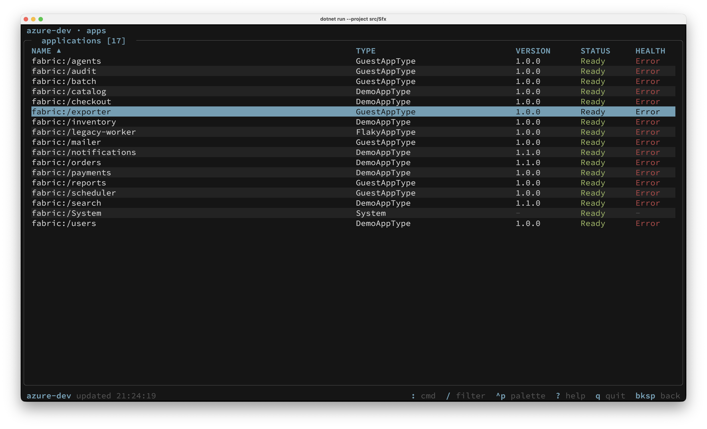
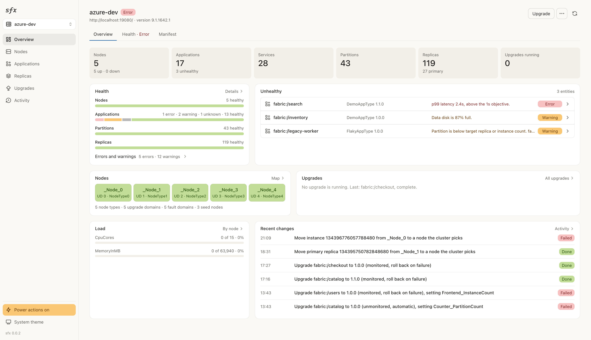

# sfx

<div align="center">
    <br>
</div>

# Introduction

An explorer for [Azure Service Fabric](https://learn.microsoft.com/azure/service-fabric/) clusters, in the terminal
and in the browser. Browse nodes, applications, services, partitions and replicas; read health, manifests, upgrades
and load; and run cluster operations, with confirmations and an action log.





## Installation

```bash
dotnet tool install -g sfx
```

## Usage

```text
sfx [-c <context>]
sfx <endpoint> [--auth <methods>] [options]
sfx context <command>
sfx ui [<endpoint> | -c <context>]
```

```bash
# An unsecured cluster, e.g. a local dev cluster
sfx localhost

# Client certificate, checking the cluster's certificate by common name
sfx mycluster.westeurope.cloudapp.azure.com --auth cert \
  --cert-file ~/certs/client.pfx --server-cn mycluster.westeurope.cloudapp.azure.com

# Microsoft Entra ID (device code sign-in)
sfx https://mycluster:19080 --auth aad --server-thumbprint 0123ABCD...
```

### Contexts

Save clusters once and switch between them with `c` or `:ctx <name>` in the UI. Contexts live in
`~/.sfx/config.toml` (or `$SFX_CONFIG`). With saved contexts but no active one, `sfx` asks which to open and makes it
the active one.

```bash
sfx context add prod mycluster:19080 --auth cert --cert-thumbprint AB12... --server-cn mycluster --readonly
sfx context add dev localhost --use
sfx context add prod-weu prod-weu.westeurope.cloudapp.azure.com --auth cert --cert-thumbprint CD34... --folder prod/europe
sfx context list
sfx -c prod
```

Folders group contexts in `sfx context list` and the `c` page; `sfx context move <name> <folder>` refiles one. A
`[folders.<path>]` table gives a folder a label and color (`success`, `warning`, `danger`, `accent` or `neutral`),
and `readonly = true` makes every context in it and its subfolders read-only:

```toml
[folders.prod]
label = "PROD"
color = "danger"
readonly = true
```

### Web

```bash
sfx ui -c prod
sfx ui -c prod --port 7080 --no-browser
```

### Keys

| Key | |
| --- | --- |
| `enter` / `l` | open the selected row |
| `d` | describe the selected row |
| `backspace` / `h` | back |
| `esc` | dismiss an error, then clear the marks, then the filter, then go back |
| `/` | filter rows, or search the text being read (`n` / `N` step through matches) |
| `:` | command, e.g. `:nodes`, `:apps`, `:cluster`, `:health`, `:ctx prod` (below); `tab` completes |
| `ctrl+p` | command palette |
| `ctrl+f` | find a node, application or service by name, type or address, or a partition by its id, and open it |
| `!` | the last error in full |
| `space` / `*` | mark the row / mark every row, to run an action on all of them at once |
| `:group` | group the rows by a column, e.g. `:group type`; `:group` alone stops grouping |
| `r` | refresh; `:refresh 2s`, `:refresh 1m` or `:refresh off` changes how often it refreshes on its own |
| `y` | copy the selected name, or the text being read |
| `?` | every key on the current page |
| `q` | quit |

On a describe page, `]` / `[` switch tabs, `#` shows line numbers and `w` wraps long lines. `up` / `down` in the
`:` and `/` prompts go through earlier entries, kept in a `history` file next to the config.

Besides nodes and applications, `:` opens views across the whole cluster:

| Command | |
| --- | --- |
| `:upgrades` (`:updates`) | the cluster's and every application's upgrade: versions, mode, domains done, state, running ones first |
| `:events` | the event store's events of the last hour, newest first; `:events 6h` looks further back |
| `:activity` | what you changed through sfx: this session's operations, running ones too, then the action log |
| `:repairs` | repair tasks: reboots, patching and other infrastructure work, active ones first |
| `:health` (`:unhealthy`) | everything unhealthy, with the reason in one line; `enter` opens it |
| `:cluster-health` | the cluster's own health evaluation |
| `:find <text>` (`:f`) | the same as `ctrl+f`, starting with `<text>`; a partition id goes straight to the partition |
| `:types` (`:apptypes`) | application types: version, status, how many applications use it, and their service types |
| `:store` (`:imagestore`) | the image store: folders and files with sizes, packages with their type and whether provisioned |
| `:provision <path>` | upload a package from disk (a folder, `.sfpkg` or `.zip`; `tab` completes the path) and provision it |
| `:error` | the last error in full, like `!` |

Actions on the selected entity use the same key everywhere: `ctrl+r` restart, `ctrl+k` remove, `ctrl+d` delete
(or unprovision a type), `m` move, `x` deactivate, `a` activate, `s` scale, `ctrl+n` create, `e` edit, `u` upgrade
(or steer the running upgrade), `o` go to a replica's node, `p` provision a package in the image store. Every change
asks for confirmation and is appended to `~/.sfx/actions.log`. Changes that take a while (restarts, moves, scaling,
deactivations, deletes, provisioning, creating, upgrades) show in the footer until the cluster has caught up.
